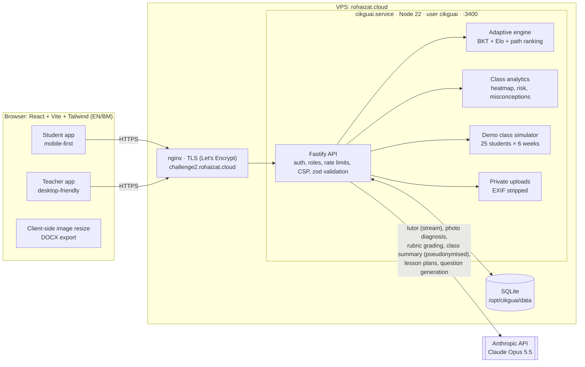

# CikguAI 🎓

**Belajar ikut rentak sendiri.** A bilingual (Bahasa Melayu + English) AI tutor, adaptive practice engine and teacher's assistant for Malaysian secondary schools (KSSM), starting with Form 2 Mathematics and Science.

- **Live:** https://challenge2.rohaizat.cloud (one-click "Try as Student" / "Try as Teacher")
- **Challenge:** Gamuda Hackathon, Challenge 2: AI for Education & Learning (AI-driven tutoring, automated assessment, adaptive learning, support for educators)

## What it does

| Side | Feature | AI / ML |
|---|---|---|
| Student | **Socratic AI tutor**: hints and questions instead of answers, maths rendered with KaTeX, photo of working → finds the wrong step | Claude (vision + language), streamed; grounded on the student's mastery |
| Student | **Adaptive quizzes**: next question targets the weakest skill at ~70% predicted success | Bayesian Knowledge Tracing + Elo/Rasch ratings |
| Student | **Learning path**: "Your next 3 things to study" with reasons (weak, recent mistakes, unlocks a later topic, review due) | Prerequisite-aware ranking over BKT estimates |
| Student | **Engagement**: XP, daily goal, streaks, 8 badges, weekly class board | — |
| Student | **Progress**: mastery radar, mastery over time, quiz history | Replays BKT estimates from the attempt log |
| Teacher | **Automated assessment**: rubric → AI draft grade with per-criterion evidence, feedback, confidence and flags → teacher reviews/overrides → releases | Claude with schema-validated structured output; scores clamped in code |
| Teacher | **Class insights**: mastery heatmap, at-risk students, repeated misconceptions, suggested groups, AI weekly summary | Deterministic analytics; AI summary sees pseudonymised data only |
| Teacher | **Lesson planner**: KSSM-aligned plan personalised with the class's data, editable, export DOCX / PDF | Claude, structured output |
| Teacher | **Worksheets**: bilingual questions with answer key; approve into the adaptive bank | Claude + code validation; or build from the calibrated bank without AI |

Also: landing page, public [/methodology](https://challenge2.rohaizat.cloud/methodology) (models, grading, responsible AI, limitations), light/dark mode, mobile-first student UI, desktop-friendly teacher UI, EN/BM toggle everywhere.

## Architecture



**Design principle:** machine learning decides *what* to practise and *how well* a skill is known (transparent, testable, no AI involved); Claude does what language models are good at (explaining, diagnosing, grading against a rubric, drafting). Anything that affects a student's record (grades, new bank questions) needs teacher approval.

### Stack and why

- **TypeScript end to end** (Fastify on Node 22, React 19 + Vite + Tailwind v4): one language, matches the other Node apps on the server, fast UI.
- **SQLite** (better-sqlite3, WAL): no extra service, one file to back up, ample for a school-scale pilot.
- **ML in TypeScript** ([server/src/ml/engine.ts](server/src/ml/engine.ts)): BKT and Elo are closed-form updates, small enough to read in one file and unit-test, with no Python runtime to maintain.
- **Anthropic SDK** with `claude-opus-5-5`: `messages.parse` + Zod schemas for every structured output (grades, plans, summaries, questions), streaming for the tutor, server-side refusal fallback, typed error mapping to friendly messages.
- **react-markdown + KaTeX**: maths renders properly and model output can't inject HTML.

## Project layout

```
server/src/
  index.ts              Fastify app: security headers/CSP, CORS, origin check, rate limits, SPA
  config.ts, db.ts      Config and SQLite schema (Malaysia time helpers)
  auth.ts               Roles (student/teacher), register/login, one-click demo, demo view switch
  content/              KSSM Form 2 curriculum, misconceptions, bilingual starter bank (~130 questions)
  ml/engine.ts          BKT, Elo, question selection, learning-path ranking (pure functions)
  learning.ts           DB wrapper: next question, record answer, XP
  seed.ts               Demo class simulator (runs the real engine)
  stats.ts, insights.ts Student progress/badges/leaderboard; class analytics
  ai/                   client (errors), tutor, grader, teacher (summary, planner, generator)
  routes/               student, tutor, assessment, teacher, planner, content
  uploads.ts            Image validation, re-encode, private storage
server/test/            Engine and question-bank unit tests (node:test)
web/src/
  pages/                Landing, Login, Methodology, student/*, teacher/*
  components/           AppShell, charts, MathText (Markdown + KaTeX), UI kit
  lib/                  API client, session, i18n (EN/BM), DOCX export, types
deploy/                 systemd unit, nginx site
scripts/deploy.sh       Build + install to /opt/cikguai + restart
docs/                   Pitch summary, demo script, future improvements
```

## Run locally

Requirements: Node 22+.

```bash
npm install
cp .env.example .env        # add ANTHROPIC_API_KEY; set PUBLIC_ORIGIN=http://localhost:5173, NODE_ENV=development
chmod 600 .env
npm run dev:server          # API on http://127.0.0.1:3400
npm run dev:web             # UI on http://localhost:5173 (proxies /api)
npm test                    # engine + question bank tests
```

Without an API key everything except the AI features works (adaptive quizzes, mastery, dashboards, worksheets from the bank, manual grading); AI buttons show a friendly "not switched on" notice.

### Environment variables

| Variable | Default | Purpose |
|---|---|---|
| `ANTHROPIC_API_KEY` | — | Anthropic API key. Only in `.env` (git-ignored, `chmod 600`). Never logged or returned. |
| `CLAUDE_MODEL` | `claude-opus-5-5` | Model for tutor, vision, grading and generation |
| `PORT` / `HOST` | `3400` / `127.0.0.1` | Listen address (behind nginx) |
| `PUBLIC_ORIGIN` | `http://localhost:5173` | Exact site origin for CORS and the cross-origin POST check |
| `DB_PATH` | `./data/cikguai.db` | SQLite file; uploads go in `uploads/` next to it |
| `UPLOAD_DIR` | (next to DB) | Optional override for private image storage |
| `NODE_ENV` | — | `production` enables secure cookies and HSTS |

## Deploy (as done on rohaizat.cloud)

The server runs nginx with one file per site, certbot's nginx plugin for TLS, and one systemd service per app under its own user in `/opt/<app>`. CikguAI follows the same pattern on port 3400.

```bash
# one-time setup
sudo useradd --system --home /opt/cikguai --shell /usr/sbin/nologin cikguai
sudo install -d -o root -g cikguai -m 750 /opt/cikguai
sudo install -d -o cikguai -g cikguai -m 750 /opt/cikguai/data
sudo install -o cikguai -g cikguai -m 600 .env.example /opt/cikguai/.env   # then edit: key, PUBLIC_ORIGIN, DB_PATH=/opt/cikguai/data/cikguai.db
sudo cp deploy/cikguai.service /etc/systemd/system/
sudo systemctl daemon-reload && sudo systemctl enable cikguai

# build + install + restart (every release)
scripts/deploy.sh

# nginx site and certificate
sudo cp deploy/challenge2.rohaizat.cloud /etc/nginx/sites-available/
sudo ln -s /etc/nginx/sites-available/challenge2.rohaizat.cloud /etc/nginx/sites-enabled/
sudo nginx -t && sudo systemctl reload nginx
sudo certbot --nginx -d challenge2.rohaizat.cloud --redirect
```

Operations: `systemctl status cikguai`, `journalctl -u cikguai -f`. Back up `/opt/cikguai/data/`.

## Security & privacy

- Sessions: random 256-bit tokens in `httpOnly`, `SameSite=Lax`, `Secure` cookies; bcrypt (cost 12); dummy-hash comparison against user enumeration.
- Role checks on every route; teachers only see their own class; private images served through an access-checked route (owner or their teacher only).
- Helmet headers, strict CSP (`script-src 'self'`), HSTS, `frame-ancestors 'none'`; CORS locked to `PUBLIC_ORIGIN`; cross-origin state-changing requests rejected.
- Rate limits: 300/min global; tutor 12/min; grading 20/min; planner/worksheets 6/min; summary 4/min; auth 5–10/min.
- Zod validation on all input; uploads ≤ 6 MB, JPEG/PNG/WebP/HEIC only, re-encoded with sharp (EXIF/GPS removed), resized client-side first.
- Student answers are treated as data in the grading prompt; class summaries send pseudonymised students only.
- systemd hardening: unprivileged user, `ProtectSystem=strict`, write access only to `data/`.

## Sources

Corbett & Anderson (1995) Knowledge tracing · Pelánek (2016) Elo in adaptive educational systems · KSSM Form 2 Mathematics and Science textbooks (chapter structure) · OECD PISA 2022 Country Note: Malaysia · The Star, 8 Sep 2026 (PISA 2025). Details: [/methodology](https://challenge2.rohaizat.cloud/methodology).
